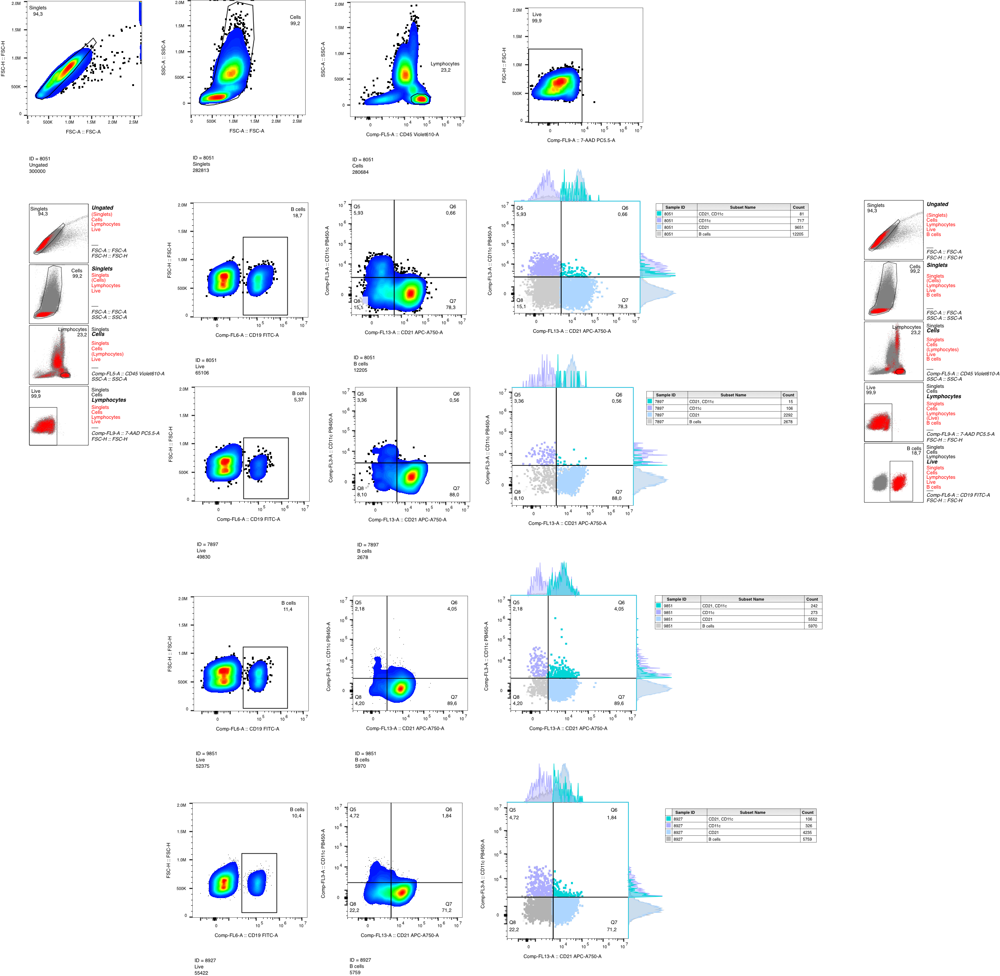
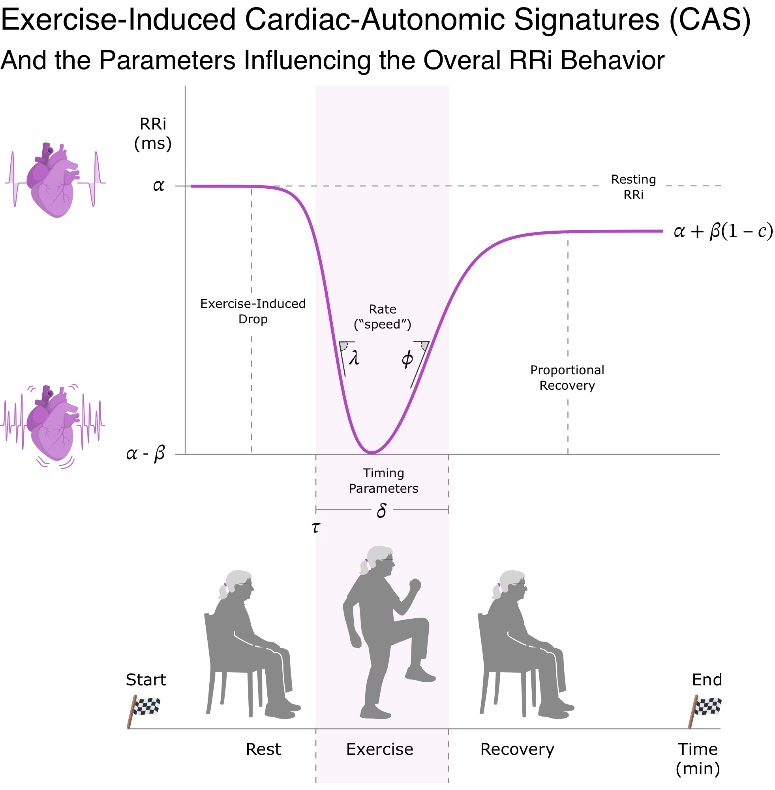
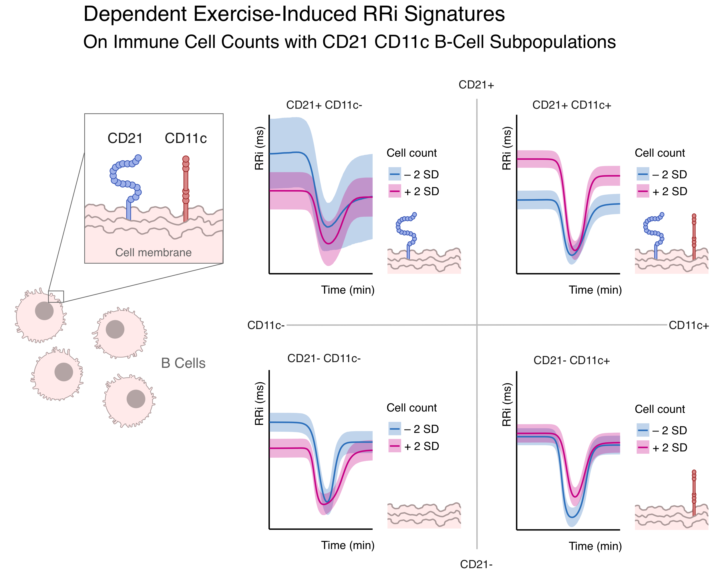
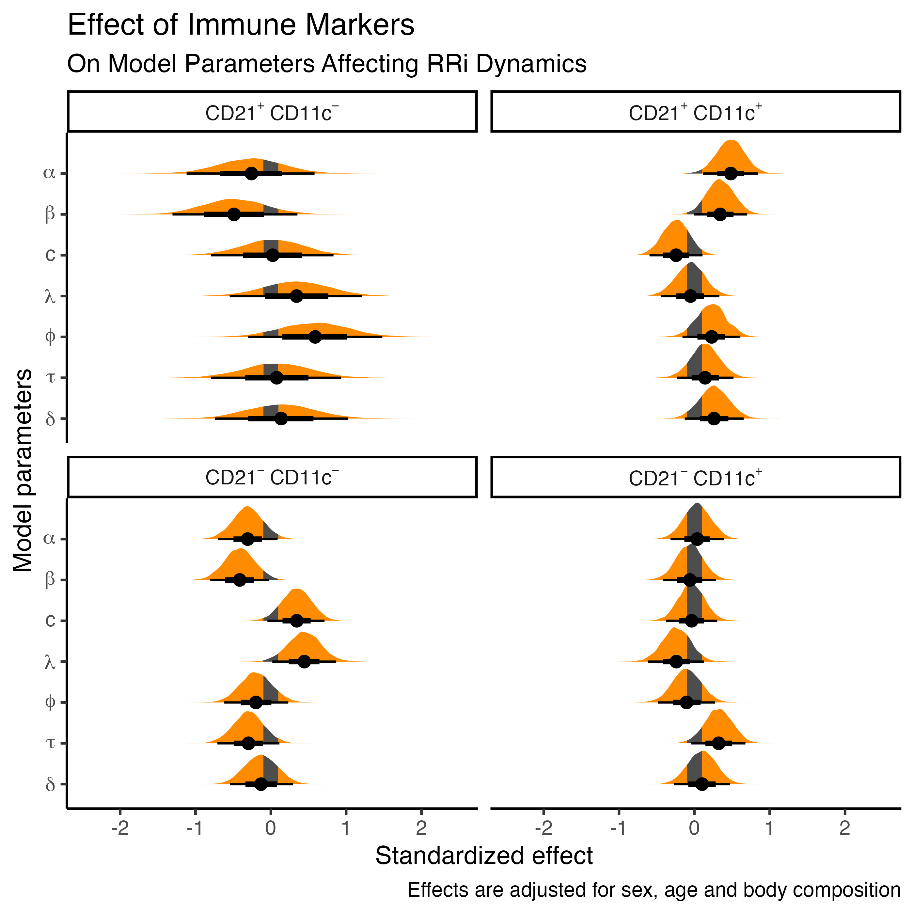

**Title**: Immune-Derived Signatures of RR-Interval Dynamics: Predicting Autonomic Responses from CD21/CD11c B-Cell Subsets

**Authors**: Matías Castillo-Aguilar^1,2^, Ginés Viscor^3^, Lindybeth Sarmiento^1,2^, Julieta Sepúlveda^1,4^, Marcelo Navarrete^1,2^, Cristian Núñez-Espinosa^1,2^ \*

::: {custom-style="Afiliation"}
^1^ Centro Asistencial Docente y de Investigación (CADI-UMAG), Punta Arenas, Chile.

^2^ Escuela de Medicina, Universidad de Magallanes (UMAG), Punta Arenas, Chile.

^3^ Physiology Section, Department of Cell Biology, Physiology and
Immunology, Faculty of Biology, Universitat de Barcelona, Barcelona, Spain.

^4^ Facultad de Ciencias de la Salud, Universidad de Magallanes (UMAG), Punta Arenas, Chile.
:::

### \*Correspondence

Cristian Núñez-Espinosa, Escuela de Medicina, Universidad de Magallanes, Punta Arenas, Chile. Centro Asistencial de Docencia e Investigación CADI-UMAG, Chile. e-mail: [cristian.nunez\@umag.cl](mailto:cristian.nunez@umag.cl). Address: Avenida Bulnes 01855, Box 113-D. Phone: +56 61 2201411.



## Abstract

**Objective**: This study aimed to investigate how aging B-cell subpopulations correlate with autonomic nervous system (ANS) dynamics, as measured by heart rate variability (HRV), in response to acute exercise in older adults.

**Material and Methods**: Using a cross-sectional design, 81 community-dwelling older adults (mean age 70.7 ± 5.8 years) underwent immune profiling to quantify total B cells and four CD21/CD11c phenotypes. Continuous R-R interval (RRi) data were recorded at rest, during a Two-Minute Step Test (TMST), and over a five-minute recovery period. A coupled-logistic RRi-vs-time model yielded seven kinetic parameters per participant. Individual parameter estimates were regressed on standardized immune predictors using multivariate Bayesian models, adjusting for age, sex and body composition variables.

**Results**: Higher counts of CD21^+^CD11c^+^ B cells were associated with elevated baseline RRi (resting vagal tone), an increased exercise-induced RRi drop, and an incomplete post-exercise recovery (posterior probability > 90%). Conversely, greater CD21^-^CD11c^-^ B-cell counts related with lower resting RRi, a pronounced sympathetic-driven RRi decrease during exercise, and more complete vagal reactivation during recovery (posterior probability > 90%).

**Conclusion**: Absolute counts of CD21^+^CD11c^+^ and CD21^-^CD11c^-^ aging B-cell subsets are differentially associated with ANS responsiveness to acute exercise in older adults. This data suggests immunosenescence-linked autonomic dysregulation. An integrative neuro-immunological approach may identify biomarkers of resilience or fragility, potentially informing personalized interventions to optimize cardiovascular health in aging.

**Keywords**: B Cells; Heart Rate Variability; Autonomic Nervous System; Aging; Exercise.



# Introduction

The intricate interplay between the nervous and immune systems, commonly referred to as the neuro-immunological axis, is fundamental for maintaining physiological homeostasis, ensuring effective responses to stressors and regulating immune responses [@bonaz2017vagus]. The autonomic nervous system (ANS), composed of sympathetic (SNS) and parasympathetic (PNS) branches, mediates bidirectional communication with the immune system. Immune derived cytokines can influence neurotransmitter release, synaptic plasticity and endocrine regulation, while in turn, autonomic pathways modulate immune cell trafficking and activation [@porter2022brain; @elia2023autonomic].

While this neuroimmune crosstalk is essential for acute responses to infection and injury, aging disrupts both systems. Immunosenescence, a hallmark of aging, encompasses widespread impairments in innate and adaptative immunity, including diminished output of naïve T and B cells, reduced vaccine responsiveness, and a chronic low-grade inflammatory state known as "inflammaging" [@jurcau2024inflammaging]. Persistent inflammatory signaling and impaired regulatory control may place sustained pressure on autonomic circuits. Conversely, autonomic dysfunction may actively shape age-related immune phenotypes [@jiang2022role; @giunta2024autonomic]. Aging, also shifts autonomic balance toward sympathetic dominance and reduced vagal tone, weakining the anti-inflammatory potential of parasimpathetic signaling [@giunta2024autonomic]. Together, these dysruptions may lower physiological resilience and contribute to chronic disease.

Within this framework, B lymphocytes warrant particular attention. In addition to antibody production, B cells function as antigen-presenting cells and cytokine producers, influencing inflammatory and neuroimmune dynamics [@wang2020b; @engler2024b]. With aging, the B cell compartment undergoes marked phenotypic shifts, including reduced naïve cells and increased memory and atypical subsets, such as age-associated B cells (ABCs). Immunophenotyping of B cells based on CD21 and CD11c expression allows for the delineation of functionally distinct B cell subsets: CD21⁻CD11c⁺ cells (ABCs), CD21⁺CD11c⁻ (naïve/resting memory), CD21⁺CD11c⁺ (activated memory), and CD21⁻CD11c⁻ (putatively anergic or dysfunctional) [@rincon2021deep]. CD11c+ B cells, often classified as ABCs, display pro-inflammatory transcriptional profiles, including robust expression of T-bet and Blimp-1, and are expanded in contexts such as aging, autoimmunity, and chronic infections [@golinski2020cd11c]. CD21, a complement receptor typically expressed on follicular B cells but is downregulated in chronically stimulated, anergic, or functionally exhausted B cell subsets, serving as a phenotypic marker of antigen exposure and altered functional state [@del2020rheumatoid]. These immunophenotypic distinctions may serve as insights into the immune system aging and may correlates of functional immune competence or dysfunction. 

Emerging evidence suggests that immune status may influence autonomic tone, and vice versa. Lymphocytes express receptors for neurotransmitters such as norepinephrine and acetylcholine via adrenergic and cholinergic receptors, and can even produce acetylcholine themselves highlighting a non-neuronal cholinergic signaling network within lymphoid tissue [@halder2021cholinergic; @jacobson2021intestinal]. The vagus nerve plays a key role in immune regulation through to via cholinergic anti-inflammatory reflex, which suppresses cytokine release during systemic inflammation [@bonaz2017vagus; @tracey2002inflammatory]. Disruption of this balance is implicated in cardiovascular, metabolic, and neurodegenerative conditions [@giunta2024autonomic]. Aging compounds these disruptions by simultaneously reducing parasympathetic tone, promoting sympathetic dominance, and perpetuating systemic inflammation [@giunta2024autonomic; @barrera2017inmunosenescencia; @frasca2023obesity]. This shift reduces the resilience of the neuro-immune axis to respond to physiological stressors

Physical activity is a powerful modulator of both autonomic and immune function in older adults. Regular exercise improves vagal tone, enhances heart rate variability (HRV), and reduces systemic inflammation [@benarroch2020physiology; @olivieri2024heart]. Immunologically, it is associated with a more balanced T and B cell phenotype, including higher proportions of naïve lymphocytes and reduced senescent subsets [@weyh2020physical; @tylutka2021lifestyle]. HRV analysis during and after submaximal exercise provides a non-invasive probe of autonomic adaptability [@castillo2023validity; @castillo2025enhancing]. Parametric modeling of HRV trajectories allows for individualized assessments of autonomic dynamics, capturing features such as recovery and flexibility [@castillo2025enhancing]. This set of parameters conforms an individual's Cardiac Autonomic Signature (CAS).

Understanding how immune B cell phenotypes, especially those altered with aging influence autonomic dynamics adaptability, could provide new insights into physiological resilience in older adults. We hypothesize that distinct B cell subpopulations, particularly CD21^+^CD11c^+^ and CD21^-^CD11c^-^ phenotypes, are associated with interindividual differences in autonomic adaptability during submaximal exercise in older adults. By integrating high-resolution immunophenotyping with dynamic modeling of heart rate variability, this study aims to identify immune correlates of autonomic resilience, advancing a novel insight into the bidirectional interplay between immune aging and CAS regulation.

# Material and Methods

## Study Design

This study employed an observational, correlational, and cross-sectional design, with a single time point data collection.

Prior to any data acquisition, all participants received a comprehensive explanation of the study's aims, procedures, and potential outcomes. In adherence to ethical standards and to ensure respect for individual autonomy, informed consent was obtained from each participant.

## Setting

This study took place at the Centro Asistencial Docente e Investigacion (CADI-UMAG), the University of Magallanes academic healthcare and research center associated with the University of Magallanes, in Punta Arenas, Chile. To minimize the impact of circadian rhythms on physiological measurements, all assessments were conducted in a controlled environment between 9:00 and 11:00 a.m.

The evaluation room was maintained at a consistent temperature of 20°C to ensure participant comfort and standardize testing conditions, thereby reducing potential influences of thermoregulation on autonomic responses. Consistent illumination was provided by artificial white lighting to prevent variations in ambient light that could affect visual or cognitive factors during the assessments. Furthermore, all evaluations were carried out in a private and quiet setting to minimize external distractions and enhance the reliability of the collected data.

## Participants

Participants were recruited from the local community through advertisements and outreach. A total of 81 older adults participated in this study, comprising 56 women and 25 men, with a mean age of 70.7 years (SD = 5.8, range 61-89). Inclusion criteria for participation were: (i) being 60 years or older at the time of enrollment; (ii) permanent residency in the Magallanes and Chilean Antarctic region, ensuring a relatively homogeneous population exposed to similar environmental and socioeconomic factors; (iii) achieving a score above 60% on the Karnofsky Performance Status scale, a common measure of functional capacity, indicating sufficient autonomy to complete the study assessments [@schag1984karnofsky]; and (iv) no prior diagnosis of conditions that could confound autonomic or cardiovascular function, such as diabetic neuropathy, pacemaker implantation, clinical depression, cognitive impairment, motor disability, or dementia.

Exclusion criteria were implemented to minimize factors that could confound autonomic measurements. Individuals were excluded if they: (i) were using beta-blockers during the study, as these medications can significantly alter autonomic and cardiovascular responses; (ii) had consumed any stimulant substances, including caffeine or sympathomimetic medications, within 12 hours prior to cardiac assessment; or (iii) had any degree of motor impairment restricting independent movement that could interfere with study procedures. Importantly, no recruited participants met these exclusion criteria.

## Procedures

Participants attended a single study visit after a 12-hour fast and abstaining from strenuous exercise and alcohol. Upon arrival, they provided informed consent and underwent a brief health screening to re-verify eligibility based on the inclusion/exclusion criteria, including blood pressure assessment (SBP <140 mmHg and DBP <90 mmHg).

Sociodemographic data, including name, age, sex, and any existing chronic medical conditions, were collected via a structured interview. This information was used to characterize the study sample and identify potential confounding factors.

Following the initial registry, body composition measurements were performed using multi-frequency bioelectrical impedance analysis (BIA) according to standardized procedures. Participants were asked to empty their bladder immediately prior to this assessment.

A 4 mL peripheral venous blood sample was collected in EDTA tubes by a trained nurse. Importantly, this blood draw ocurred prior to any physical exertion or baseline physiological measurements, to avoid any acute exercise-induced immunological alterations. These samples were gently homogenized and kept at room temperature for subsequent immunophenotypic analysis, being processed within two hours of collection.

Following a minimum 10-minute rest period in a seated position, participants were fitted with a Polar H10 heart rate monitor for continuous R-R interval recording and an Omron Hem-7142 monitor for blood pressure measurements. After baseline physiological measurements (HRV segment at rest, BP), participants performed the Two-Minute Step Test (TMST) as an acute physiological stressor. R-R intervals were recorded continuously during the 2-minute test and for a 5-minute recovery period immediately afterward. Blood pressure was measured again immediately after completion of the TMST to ensure participant safety.

## Assessments

### Body Composition

Body composition, including body mass index (BMI), body fat percentage, lean muscle mass, body water, and bone mass, was assessed using multi-frequency bioelectrical impedance analysis (BIA). Measurements were performed using the Tanita BC-558 Iron-man Seg-mental Body Composition Monitor (Tanita Ironman, Ar-lington Heights, IL 60005 USA). Participants were instructed to fast for at least 4 hours prior to the assessment and to avoid strenuous exercise and alcohol consumption for at least 12 hours. They were also asked to empty their bladder before the measurement. Participants stood barefoot on the device's foot electrodes and held the hand electrodes while wearing light clothing.

### Two-Minute Step Test (TMST)

The Two-Minute Step Test (TMST), a standardized protocol from the Senior Fitness Test battery [@rikli1999functional], was used as an acute, exercise-induced physiological stressor to challenge cardiac autonomic control. While also providing an index of lower body endurance and functional mobility, the TMST's primary role in this study was to elicit a controlled, submaximal physiological perturbation suitable for assessing dynamic autonomic responses in older adults. Participants were instructed to march in place for two minutes, lifting their knees to a midpoint between the patella and the iliac crest, guided by verbal cues. The total number of steps completed served as a measure of exercise volume and functional performance. A trained kinesiologist counted the steps, and participants received verbal encouragement to maintain consistent effort and proper form throughout the two-minute period. Rest was allowed if needed, with participants encouraged to resume the test as soon as possible.

During the TMST, R-R intervals were continuously recorded using Polar H10 heart rate monitors to assess HRV dynamics before, during, and after exercise. Additionally, blood pressure (BP) was measured immediately before and after the test to evaluate safety, physiological adaptations, and recovery using the Omron Hem-7142 monitor.

The TMST was performed after a 10-minute rest period, followed by a 5-minute recovery period (12 minutes total). The total number of steps completed in two minutes was recorded as the outcome measure for functional capacity, while the physiological stress induced by this standardized exertion served as the basis for assessing dynamic autonomic responses.

### Immune Profiling and B Cell Phenotyping

To characterize B cell subpopulations, including age-associated B cells (ABCs), we used fluorochrome-conjugated monoclonal antibodies (mAbs) specific for human CD45 (Brilliant Violet 570, clone HI30, BioLegend), CD19 (FITC, clone HIB19, BioLegend), CD21 (APC A750, clone Bu32, BioLegend) and CD11c (PB 450, clone 3.9, BioLegend). A viability marker (7-AAD PC5.5, BioLegend) was also included to exclude dead cells. All antibodies were used at manufacturer-recommended concentrations.

Peripheral blood samples were collected in 4 ml EDTA tubes and processed within 2 hours of collection. For each assay, 100 µL of whole blood (approximately 1×10^6^ cells) were incubated with the antibody cocktail for 30 minutes at room temperature in the dark. After staining, red blood cells were lysed by adding 125 µL of OptiLyse C (Beckman Coulter), followed by brief mixing and a 10-minute incubation in the dark. Cells were then washed with 1 mL of IsoFlow™ buffer (Beckman Coulter) to remove debris and unbound antibodies.

Stained samples were acquired on a Beckman Coulter Model S flow cytometer (Beckman, CA, USA), and analyzed using FlowJo software (Tree Star, OR, USA). A minimum of 100.000 CD19^+^ events were acquired per sample. Fluorescence compensation was performed using single-stained compensation beads (BioLegend). Fluorescence minus one and isotype-matched Ab controls were used to set analysis gates.

Gating strategy included sequential selection of CD45^+^ lymphocytes, exclusion of 7-AAD^+^ dead cells, and identification of CD19^+^ B cells. B cell subsets were defined based on the differential expression of CD21 and CD11c. Age-associated B cells (ABCs) were defined as CD19^+^CD11c^+^CD21^-^. Additional subsets included CD19^+^CD21^+^CD11c^-^ (naïve/central memory B cells), CD19^+^CD21^+^CD11c^+^ (activated memory B cells), and CD19^+^CD21^-^CD11c^-^ (putative anergic or dysfunctional B cells). Subset definitions were based on previously reported phenotypic profiles of human B cells [@mcgrath2024correlation; @pinto2023human].

Sequential gating strategy can be observed in [Figure 1](#fig-1).

{width=100%}

[**Figure 1**]{#fig-1}. Sequentual gating strategy for the identification of ABCs defined as CD19^+^CD11c^+^CD21^-^, naïve/central memory B cells as CD19^+^CD21^+^CD11c^-^, activated memory B cells CD19^+^CD21^+^CD11c^+^, and putative anergic or dysfunctional B cells as CD19^+^CD21^-^CD11c^-^. Four individual samples are shown in the last four rows depicting inter individual variability in CD21/CD11c heterogeneity with each subpopulation highlighted with corresponding marginal distributions respectively. A minimum of 100.000 CD19^+^ events were acquired per sample.

## Statistical Analysis

We employed a fully Bayesian modeling framework to characterize how cardiac autonomic modulation responds to exercise in the presence of multiple confounding influences. Bayesian inference was preferred over traditional frequentist methods because it provides complete posterior distributions for all parameters, thereby allowing thorough quantification of uncertainty and probabilistic interpretation via credible intervals [@van2021bayesian]. By incorporating prior information, either drawn from existing literature or specified as weakly regularizing distributions, we constrained implausible parameter values, mitigated the impact of outliers, and improved convergence during model fitting.

For descriptive statistics, continuous variables are summarized as mean +/- standard deviation (M ± SD), while categorical variables are reported using absolute counts (n) and relative frequencies (%).

### RRi-vs-Time Model

In order to obtain each individual's exercise-induced CAS, we model the R-R intervals (RRi) across a complete rest-exercise-recovery protocol, as early described [@castillo2025enhancing]. Under this specification, each observed RRi is assumed to follow a normal distribution centered on a time-dependent function. This data generation process is depicted in @eq-data-generation-process.

$$
\mathrm{RRi} \sim \mathcal{N}(f(t \mid \theta_k),\,\sigma^2)
$${#eq-data-generation-process}

Here, $\sigma^2$ represents the variance term, and the function $f(t \mid \theta_k)$ takes the form described in @eq-mca-model.

$$
f(t \mid \theta_k) = \alpha + \underbrace{\frac{\beta}{1 + e^{\lambda (t - \tau)}}}_{\mathrm{Drop\,Phase}} - \underbrace{\frac{c \beta}{1 + e^{\phi (t - \tau - \delta)}}}_{\mathrm{Recovery\,Phase}}
$${#eq-mca-model}

The parameter vector $\theta_k = \{\alpha,\beta,c,\lambda,\phi,\tau,\delta\}$ governs the shape of the RRi trajectory over time. Specifically, the parameters $\alpha$, $\beta$, and $c$ are magnitude parameters: $\beta$ controls the initial drop in RRi during exercise, $c\beta$ controls the subsequent recovery magnitude, and $\alpha$ serves as the baseline RRi level. The parameters $\lambda$ and $\phi$ are rate parameters that determine the steepness (i.e., the speed) of the drop and recovery transitions, respectively. Finally, the timing parameters $\tau$ and $\delta$ indicate when the drop phase begins and how the recovery phase onset is shifted relative to $\tau$.

### Two-Step Modeling Strategy

Our modeling proceeded in two distinct stages. First, for each individual, we obtained cardiac-autonomic signature (RRi-vs-time, $\alpha,\beta,c,\lambda,\phi,\tau,\delta$) using the R package *CardioCurveR* (v1.0.0). This package implements a box-constrained quasi-Newton algorithm with a Huber loss function for robust parameter estimation [@cardiocurverPackage].

Second, we specified two multivariate Bayesian regression models in which each invidual's cardiac-autonomic signature component ($\widehat{\theta}_{ik}$) served as a response. Concretely, for the $k$th parameter of subject $i$ we let the conditional mean

$$
\mu_{k,i} = \beta_{k,0} + \sum_{p=1}^{6} \beta_{k,p} x_{p,i}
$${#eq-second-model}

where $x_{i1},\dots,x_{i6}$ denote the six centered and scaled immune-cell predictors (absolute lymphocyte count, total B-cell count, and the four B-cell subpopulations defined by CD21/CD11c expression). In the first model, we regressed $\widehat{\theta}_{ik}$ on those six immune predictors via @eq-second-model. In the second model, we extended @eq-second-model by adding four additional terms, $\beta_{k,\mathrm{age}} (\mathrm{age}_i)$, $\beta_{k,\mathrm{sex}} (\mathrm{sex}_i)$, $\beta_{k,\mathrm{fat}} (\mathrm{fat}_i)$ and $\beta_{k,\mathrm{muscle}} (\mathrm{muscle}_i)$, to account for confounding by age, sex and body composition variables when modeling cardiac-autonomic signatures. Prior to fitting either multivariate model, all continuous predictors (immune counts and age) were centered to their mean and scaled by their standard deviation. We specified $\mathcal{N}(0,3)$ priors on every main-effect coefficient $\beta_{k}$ to exert a weakly regularizing influence and to mitigate the impact of outliers [@lemoine2019moving].

### Model Fitting and Inference

Bayesian estimation employed the No-U-Turn Sampler (a variant of Hamiltonian Monte Carlo) as implemented in the *brms* (v2.22.0) and *rstan* (v2.32.7) packages in R [@rlanguage]. For each multivariate model, five Markov chains were run, each with 2000 warm-up iterations followed by another 2000 sampling iterations, resulting in 10000 post-warmup samples per parameter.

Inference followed the SEXIT (Sequential Effect eXistence and Significance Testing) framework [@makowski2019indices]. For each estimated parameter and its corresponding posterior distribution, we report the posterior median and its 95% highest-density credible interval (HDI). We also present the probability of direction (pd) as a quantitative measure of effect existence. Practical significance (ps) is indexed by the proportion of the posterior mass falling outside a region of practical equivalence (ROPE). The ROPE was defined as ±0.1 times the standard deviation of the response variable, and to ensure consistency all predictors were standardized prior to modeling [@makowski2019indices].

### Model Diagnostics

To verify sampling convergence and stability, we checked that the potential scale reduction factor ($\hat{R}$) for every parameter was below 1.01 and that the effective sample size exceeded 1,000. We also inspected trace plots visually to confirm adequate chain mixing and performed posterior predictive checks to ensure the model's predicted RRi distributions aligned with the observed data. All analyses were fully implemented in R [@rlanguage].

Further model diagnostics, parameters and posterior statistics are available in the supplementary material.

# Results

```{r}
#| include: false

## Load libraries
library(brms)
library(data.table)
library(gtsummary)

## Load auxiliary functions
source("../R/_functions.R")

normalize_text <- function(x) {
    x <- stringi::stri_trans_general(x, "latin-ascii")
    clipr::write_clip(x)
    return(x)
}

## Load data objects
data <- readRDS("../models/m_data.RDS") # Data used in the models
model <- readRDS("../models/m_mod_2.RDS") # Adjusted model
```

## Sample Characteristics

The samples consisted of 81 subjects with 70.6 ± 5.8 years old (age range, 61 to 89 years old), with 25 (30.9%) males and 56 (69.1%) females. The rest of the characteristics of the collected sample are presented in [table 1](#tab-1).

[**Table 1**]{#tab-1}. Sample characteristics in sociodemographical, body composition and immunological variables. Data is presented as mean ± standard deviation. Comparison for each variable between males and females is based on the standardized mean difference and its corresponding 95% confidence interval (95% CI).

```{r}
#| echo: false

data[, sex := factor(sex, levels = c("F", "M"), labels = c("Females", "Males"))]
tbl_data <- data[, c(15:21,9:14)]

tbl_data[, id := seq_len(.N)]

tbl_data[, cd21_m_cd11c_m_perc := (cd21_m_cd11c_m/abc_linfocitosb_total)*100, id]
tbl_data[, cd21_m_cd11c_p_perc := (cd21_m_cd11c_p/abc_linfocitosb_total)*100, id]
tbl_data[, cd21_p_cd11c_m_perc := (cd21_p_cd11c_m/abc_linfocitosb_total)*100, id]
tbl_data[, cd21_p_cd11c_p_perc := (cd21_p_cd11c_p/abc_linfocitosb_total)*100, id]

tbl_data[, id := NULL]

setcolorder(tbl_data, 
            neworder = c("sex", "age",
                         "weight", "height",
                         "imc", "muscle_total",
                         "fat_total",
                         "abc_linfocitos_total",
                         "abc_linfocitosb_total",
                         "cd21_m_cd11c_p",
                         "cd21_m_cd11c_p_perc",
                         "cd21_p_cd11c_p",
                         "cd21_p_cd11c_p_perc",
                         "cd21_p_cd11c_m",
                         "cd21_p_cd11c_m_perc",
                         "cd21_m_cd11c_m",
                         "cd21_m_cd11c_m_perc"))

tbl_data |> 
  tbl_summary(by = sex,
            missing = "no",
            statistic = list(
              all_continuous() ~ "{mean} ± {sd}"
            ),
            label = list(
              age ~ "Age (years old)",
              weight ~ "Weight (kg)",
              height ~ "Height (cm)",
              imc ~ "BMI (kg/m2)",
              muscle_total ~ "Muscle mass (kg)",
              fat_total ~ "Body fat (%)",
              abc_linfocitos_total ~ "Total lymphocytes (n)",
              abc_linfocitosb_total ~ "Total B cells (n)",
              cd21_m_cd11c_p ~ "CD21- CD11c+ B cells (n)",
              cd21_m_cd11c_p_perc ~ "CD21- CD11c+ B cells (%)",
              cd21_p_cd11c_p ~ "CD21+ CD11c+ B cells (n)",
              cd21_p_cd11c_p_perc ~ "CD21+ CD11c+ B cells (%)",
              cd21_p_cd11c_m ~ "CD21+ CD11c- B cells (n)",
              cd21_p_cd11c_m_perc ~ "CD21+ CD11c- B cells (%)",
              cd21_m_cd11c_m ~ "CD21- CD11c- B cells (n)",
              cd21_m_cd11c_m_perc ~ "CD21- CD11c- B cells (%)"
            ),
            digits = list(everything() ~ 2,
                          cd21_m_cd11c_p ~ 0,
                          cd21_p_cd11c_p ~ 0,
                          cd21_p_cd11c_m ~ 0,
                          cd21_m_cd11c_m ~ 0)) |> 
  add_overall() |> 
  add_difference(test = list(all_continuous() ~ "smd")) |> 
  modify_spanning_header(all_stat_cols(stat_0 = F) ~ "**Sex**") |> 
  remove_abbreviation() |> 
  remove_footnote_header() 
```

Notably, the proportion of age-associated B cells (ABCs; CD19^+^CD11c^+^CD21^-^) in our cohort was (3.68% ± 2.26%), a level that is comparable to that reported by McGrath et al. (2024), potentially reflecting context-dependent variation linked to population characteristics or disease state [@mcgrath2024correlation].

The immunophenotypic classification of B cell subsets in our study mirrors functionally distinct states described in previous literature: CD21^+^CD11c^-^ cells are typically associated with naïve or central memory phenotypes, whereas CD21^-^CD11c^+^ and CD21^-^CD11c^-^ subsets have been linked to heightened activation, antigen experience, or anergic/exhausted profiles [@sosa2022cd11c; @tangye2009memory].

These findings are consistent with earlier reports demonstrating an expansion of ABCs in the context of aging and autoimmune conditions, reinforcing their relevance as immunological biomarkers [@pinto2023human].

A detailed characterization aggregated by age and sex can be observed in Figure S1, found in section "B Cell Subpopulation Distribution" in the supplementary material.

## Exercise-Induced Cardiac Autonomic Trajectory

Exercise elicits a U-shaped form on RRi during a rest-exercise-recovery protocol. This shape is controlled by the model parameters depicted in [Figure 2](#fig-2).

{width=100%}

[**Figure 2**]{#fig-2}. Cardiac Autonomic Signature given by RRi dynamics in response to exercise as described by the RRi-vs-time model. The image also depicts the rest-exercise-recovery protocol used to induce the autonomic changes in response to physical exertion. Parameters $\alpha,\beta,c$ control the magnitude of change, $\lambda,\phi$ control the steepnees or speed of change, and $\tau,\delta$ control de timing of these changes in RRi dynamics.

<!--- ## See output from "R/rri-characteristics.R"
   Parameters Estimate    SE               CI
       <fctr>    <num> <num>           <char>
1:      alpha   884.77 21.60 [840.27, 925.77]
2:       beta   403.99 24.57  [355.6, 451.58]
3:          c     0.89  0.02     [0.84, 0.94]
4:     lambda     3.01  0.22     [2.57, 3.44]
5:        phi     2.18  0.27     [1.63, 2.71]
6:        tau     6.89  0.11     [6.66, 7.11]
7:      delta     2.50  0.11     [2.28, 2.72]
--->

In our sample, the baseline RRi controlled by $\alpha$ was 884.77 ms (CI~95%~[840.27, 925.77]), with an exercise induced drop ($\beta$) of 403.99 (CI~95%~[355.6, 451.58]). The recovery proportion ($c$ parameter) relative to $\beta$ was 0.89 (CI~95%~[0.84, 0.94]). 

In relation to the rate parameters, controlling the speed of transition between exercise and recovery phases, we observed a rate of exercise-induced decay ($\lambda$) of 3.01 min^-1^ (CI~95%~[2.57, 3.44]) and a post exercise recovery rate ($\phi$) of 2.18 min^-1^ (CI~95%~[1.63, 2.71]).

For time parameters controlling the timing of the aforementioned RRi kinetics, we observed that the time of the exercise-induced ($\tau$) drop aligned at 6.89 (CI~95%~[6.66, 7.11]) and a duration of the exertion-related RRi depression ($\delta$) was prolonged for 2.50 (CI~95%~[2.28, 2.72]).

## B Cell Expression on Cardiac Autonomic-Immune Axis

The overall exercise-induced Cardiac Autonomic Signature is associated with the distribution of distinct B cell subsets. The specific morphological changes of the RRi-vs-time curve are dependent on the independent variation of both CD21 and CD11c B cell markers. The main immune-autonomic associations derived by different B cell subsets can be seen in [Figure 3](#fig-3).

{width=100%}

[**Figure 3**]{#fig-3}. Predicted exercise-induced RRi signatures, dependent on CD21 and CD11c B cell expressions. Each RRi-vs-time curve correspond to the estimated Cardiac Autonomic Signature (line: median, shaded area: 95% high density interval, HDI) for the corresponding combination of B cell phenotypes (of CD21 and CD11c) below and above two standard deviations (blue and violet shaded areas), while keeping the remaining cell markers counts constant at their mean. Depicted effects are adjusted for confounding variables.

### CD21^+^ / CD11c^-^

```{r}
#| eval: false
#| echo: false
report_model(model, variable = "cd21_p_cd11c_m")
```

A higher proportion of CD21^+^CD11c^-^ B cells, typically representing naïve or central memory phenotypes, were associated with more than 80% posterior probability of having a less pronounced decrease in RRi (ES on $\beta$ = -0.45, CI~95%~[-1.29, 0.32], pd = 86%, ps = 80.2%), and a steeper exercise-induced autonomic transition, both at onset (ES on $\lambda$ = 0.43, CI~95%~[-0.41, 1.29], pd = 83.7%, ps = 77.3%) and recovery (ES on $\phi$ = 0.49, CI~95%~[-0.36, 1.34], pd = 87.8%, ps = 82.2%). 

### CD21^+^ / CD11c^+^

```{r}
#| eval: false
#| echo: false
report_model(model, variable = "cd21_p_cd11c_p")
```

In contrast, CD21^+^CD11c^+^ B cells, linked to activated or antigen-experienced states, were associated with a 99.5% posterior probability of higher RRi at rest (ES on $\alpha$ = 0.48, CI~95%~[0.11, 0.84], pd = 99.5%, ps = 97.9%), 97.3% posterior probability of more pronounced exercise-induced RRi decrease (ES on $\beta$ = 0.34, CI~95%~[0, 0.71], pd = 97.3%, ps = 91.5%), 91.5% posterior probability of incomplete post-exercise RRi recovery (ES on $c$ = -0.24, CI~95%~[-0.6, 0.1], pd = 91.5%, ps = 79.1%) and 90.5% posterior probability of prolonged RRi depression following exertion (ES on $\delta$ = 0.26, CI~95%~[-0.12, 0.67], pd = 90.5%, ps = 79.5%).

### CD21^-^ / CD11c^-^

```{r}
#| eval: false
#| echo: false
report_model(model, variable = "cd21_m_cd11c_m")
```

The CD21^-^CD11c^-^ subset, often associated with anergic or exhausted B cells, was linked to 93.5% posterior probability of lower baseline vagal tone (ES on $\alpha$ = -0.31, CI~95%~[-0.7, 0.09], pd = 93.5%, ps = 84.7%), but also a 98.2% posterior probability of less marked exercise-induced RRi drop (ES on $\beta$ = -0.41, CI~95%~[-0.8, -0.02], pd = 98.2%, ps = 94.2%), with a 96.1% posterior probability of a more complete post-exercise recovery (ES on $c$ = 0.34, CI~95%~[-0.04, 0.72], pd = 96.1%, ps = 89.2%). In addition, these cells were associated with a 98% posterior probability of steeper RRi drop (ES on $\lambda$ = 0.44, CI~95%~[-0.01, 0.84], pd = 98%, ps = 94.4%) and 92.8% posterior probability of early onset (ES on $\tau$= -0.3, CI~95%~[-0.68, 0.14], pd = 92.8%, ps = 83.5%).

### CD21^-^ / CD11c^+^

```{r}
#| eval: false
#| echo: false
report_model(model, variable = "cd21_m_cd11c_p")
```

Finally, a greater proportion of CD21^-^CD11c^+^ B cells, commonly described as age-associated B cells (ABCs), were associated with a 73% posterior probability of having a less steep RRi drop (ES on $\lambda$ = -0.24, CI~95%~[-0.61, 0.13], pd = 90.2%, ps = 76.8%) and 95.9% posterior probability of delayed onset of autonomic engagement (ES on $\tau$ = 0.32, CI~95%~[-0.04, 0.68], pd = 95.9%, ps = 88.7%).

The posterior distribution for each effect for all B cell phenotypes on the different parameters controlling the exercise-induced RRi dynamics can be seen in [Figure 4](#fig-4).

{width=100%}

[**Figure 4**](#fig-4). Posterior distribution of the standardized effect of B cell CD21 and CD11c expression on model parameters influencing the exercise-induced cardiac autonomic dynamics. $\alpha$ controls the baseline RRi; $\beta$ is proportional to the RRi drop, induced by exercise; $c$ is the recovery proportion, relative to $\beta$; $\lambda$ and $\phi$ are the steepness of exercise-induced RRi drop and post exercise recovery; $\tau$ correspond to the time at which the exercise-induced RRi drop occurs; $\delta$ correspond to the time-duration of the RRi depression, relative to $\tau$, that takes before the recovery kinetics begin.

# Discussion

Our findings reveal a compelling dichotomy in the relationship between specific B cell subpopulations and autonomic dynamics during exercise in older adults. Individuals with a higher proportion of CD21^+^/CD11c^+^ (double positive) B cells exhibited characteristics of heightened parasympathetic activity at rest, including elevated baseline vagal tone and a longer resting RR intervals. This group also displayed an increased sympathetic response during exercise, indicated by an abrupt drop in RRi, a decreased cardiac recovery post-exercise and a longer time-to-recovery began. Conversely, participants with a predominance of CD21^-^/CD11c^-^ (double negative) B cells showed the opposite autonomic profile: low baseline vagal tone characterized by shorter RR and intervals. They also presented a decreased sympathetic response to physical exertion, reflected in a smaller, but steeper, drop in RRi, and a more close-to-baseline heart rate return following exercise. These contrasting observations suggest that the relative abundance of these B cell subpopulations may serve as an indicator of an individual's autonomic balance, with the CD21^+^/CD11c^+^ phenotype aligning with a vagally dominant state with increased sympathetic reactivity, while the CD21^-^/CD11c^-^ phenotype corresponds to a more sympathetically inclined state coupled with efficient compensatory vagal recovery capacity.

### CD21^+^/CD11c^+^ Subpopulation: Increased Vagal Tone and Modulated Sympathetic Reactivity

The association of a higher proportion of CD21^+^/CD11c^+^ B cells with elevated resting parasympathetic tone is consistent with the established benefits of higher vagal activity, including lower systemic inflammation and improved health status [@olivieri2024heart]. This vagotonic profile, often marked by increased HRV, has been shown to correlate inversely with pro-inflammatory cytokines [@marsland2007stimulated; @arias2022association], suggesting a more regulatory immunological microenvironment potentially influenced by the cholinergic anti-inflammatory reflex [@tracey2002inflammatory; @giunta2024autonomic]. Furthermore, vagal signaling appears to promote IgA production and maintain barrier immune homeostasis [@mcloughlin1976iga], possibly through the preferential localization of CD21^+^/CD11c^+^ memory B cells in lymphoid tissues with rich cholinergic innervation, such as the spleen and lymph nodes [@bonaz2017vagus], where acetylcholine (ACh) could modulate their functions towards a more anti-inflammatory and regulatory phenotype [@jacobson2021intestinal].

The increased sympathetic response during exercise observed in this group is another notable finding. Moreover, a high resting vagal tone typically leads to a more pronounced vagal withdrawal at the onset of exercise, which aligns well with the observed data, suggesting a more pronounced initial heart rate acceleration, potentially due to increased vagal withdrawal and cholinergic modulation of the autonomic nervous system (ANS) [@giunta2024autonomic]. Cholinergic activation has been shown to counteract sympathetic signals, and a blunted adrenergic response might also limit the exercise-induced mobilization of lymphocytes [@smith2025exercise], potentially preventing marked immune activation in response to physical stress, thus suggesting a more controlled immune state in individuals with a dominant vagal influence.

However, this vagal-centric profile was also characterized by a slower return to baseline heart rate after exercise. Despite a less pronounced initial increase in heart rate, individuals with more CD21^+^/CD11c^+^ B cells took longer to recover at the same extent that individuals with greater CD21^-^/CD11c^-^. This protracted recovery could stem from a less efficient re-establishment of autonomic balance following a moderated sympathetic response, where the sympathetic nervous system (SNS) might not have been sufficiently activated to trigger a strong subsequent vagal rebound. Alternatively, it might indicate a degree of autonomic rigidity [@castillo2025enhancing], where a predominantly parasympathetic system at rest exhibits difficulty in rapidly adjusting after a perturbation. The lower $c$ parameter (recovery proportion of the RRi curve) observed in this group supports the notion of reduced autonomic flexibility, suggesting that while a basal anti-inflammatory environment might be present, the capacity for rapid adaptation to acute physiological challenges could be limited.

The characteristics associated with a higher proportion of CD21^+^/CD11c^+^ B cells find parallels in active older adults, who often display high resting HRV and moderated cardiovascular responses to exercise [@mabe2024associations], along with less inflammatory immune profiles [@tylutka2021lifestyle]. This suggests that these memory B cells might serve as both a marker and a modulator of this physiological state. While CD11c^+^ B cells in healthy individuals can differentiate into plasmablasts upon stimulation [@golinski2020cd11c], they also exhibit some resistance to regulatory signals like IL-10 [@golinski2020cd11c], implying potential modulation by neuroendocrine pathways. Future research into the effects of interventions such as chronic vagal nerve stimulation on these cells could be valuable in exploring ways to enhance their anti-inflammatory profile while preserving their capacity for immune response when needed.

### CD21^-^/CD11c^-^ Subpopulation: Sympathetic Predominance and Compensatory Response

In contrast, older adults with a higher proportion of CD21^-^/CD11c^-^ B cells presented an autonomic profile indicative of sympathetic predominance at rest and during exercise, coupled with an efficient vagal recovery post-exercise. The low baseline vagal tone observed in this group supports the idea that these double negative B cells are associated with a microenvironment of chronic immune stimulation and inflammation, as reduced CD21 expression is often a hallmark of anergic or exhausted B cells resulting from continuous antigenic stimulation [@del2020rheumatoid], conditions frequently linked with chronic sympathetic activation [@giunta2024autonomic]. Our findings align with studies demonstrating that chronically low HRV in older individuals is associated with higher levels of pro-inflammatory cytokines [@jiang2022role], suggesting that an accumulation of CD21^-^ B cells tends to coexist with sympathetic dominance and inflammaging. Prolonged exposure to pro-inflammatory signals can induce a senescence-like phenotype in B cells [@frasca2023obesity], further suggesting that a predominance of CD21^-^/CD11c^-^ B cells may reflect chronic immunometabolic stress and related sympathetic overactivation.

During exercise, this subpopulation exhibited an amplified autonomic response, with the marked tachycardia, reflected in a lower $\alpha$ and greater $\lambda$ parameters, indicating a robust sympathetic discharge. This heightened response is consistent with their low baseline parasympathetic tone; with less vagal "braking", the cardiovascular system responds rapidly and intensely to the exercise stimulus. While potent acute sympathetic activation has advantages such as increased cardiac output and immune cell mobilization [@smith2025exercise], potentially contributing to the clearance of senescent cells through exercise [@simpson2021exercise], it also carries potential risks, including cardiac arrhythmias and increased inflammation.

A notable and potentially beneficial finding was the better autonomic recovery (high $c$ parameter) observed in the CD21^-^/CD11c^-^ group despite their lower initial vagal tone. This suggests a compensatory and efficient vagal reactivation following the sympathetic surge, possibly mediated by baroreceptor and mechanoreceptor reflexes responding to the exercise-induced cardiovascular changes [@besnier2017exercise]. This efficient cholinergic recovery could aid in resolving immune activation once the exercise stimulus ceases. Thus, individuals with a more sympathicotonic profile might be capable of mounting strong but transient responses, followed by a relatively rapid return to autonomic balance mediated by the parasympathetic nervous system. This pattern resonates with descriptions of mild autonomic insufficiency, where sympathetic hyper-responsiveness can coexist with late vagal hyper-reactivity [@besnier2017exercise], and aligns with the concept of autonomic resilience [@castillo2025enhancing].

This autonomic and immune profile shares similarities with clinical conditions such as metabolic syndrome and obesity, where reduced HRV and high basal sympathetic activity are often observed, although some form of interventions can improve vagal reactivity [@tylutka2021lifestyle; @frasca2023obesity]. The link between alterations in B cells and autonomic behavior suggests a bidirectional relationship, where not only can the immune profile influence the autonomic response, but also that modulating the ANS can potentially impact age-associated immune alterations, as seen with chronic exercise interventions [@weyh2020physical; @tylutka2021lifestyle].

### Strengths and Limitations

This study offers a novel contribution by integrating autonomic physiology, through nonlinear modeling of RRi dynamics, with detailed B-cell phenotyping in the context of healthy aging. The application of a coupled logistic framework allowed us to capture temporally resolved autonomic shifts during exercise and recovery, providing a more dynamic assessment compared to standard HRV metrics, while controlling for key demographical and body composition variables. Our findings, which highlight distinct associations between CD21/CD11c B-cell subsets and specific autonomic parameters, offer new avenues for understanding immune-ANS interactions.

However, several limitations warrant consideration. The cross-sectional design of our study precludes the establishment of causal inferences between the observed immune and autonomic characteristics. Furthermore, while surface marker-based phenotyping allowed for the identification of specific B-cell subpopulations, it did not elucidate their functional or mechanistic relevance. The absence of functional assays or transcriptomic profiling to complement the flow cytometry data, along with the unquantified potential for batch or gating effects, represents a further limitation. Methodologically, our two-stage modeling pipeline did not propagate posterior uncertainty between steps, underscoring the need for future work employing fully joint hierarchical inference.

As CD21/CD11c-defined B cell subsets are mutually exclusive by definition, changes in one subpopulation necessarily imply reciprocal changes in the others. While our multivariate Bayesian model estimates marginal effects by standardizing and adjusting for all predictors simultaneously, the simulated trajectories shown in Figure 3 represent theoretical contrasts in which a single subpopulation is increased while others are held at their mean. This approach facilitates interpretation but does not reflect biologically possible immune configurations, and future modeling strategies may benefit from compositional or constraint-based approaches.

Moving forward, future research should aim to overcome these limitations by employing longitudinal study designs to explore causality, and incorporating functional and mechanistic analyses to understand the roles of the identified B-cell populations to further elucidate the complex interplay between the immune and autonomic systems in aging.

# Conclusion

This research suggests that B cell subpopulations reflect and potentially modulate ANS dynamics during exercise in older adults. An integrative neuro-immunological approach provides a more comprehensive understanding of the health status of older individuals, identifying "pro-resilient" versus "pro-fragile" profiles that might not be evident when evaluating systems separately. Individuals with a predominance of CD21^+^/CD11c^+^ B cells exhibit higher baseline vagal tone, an increased sympathetic response during exercise, but an incomplete autonomic recovery. In contrast, those with CD21-/CD11c- B cells present lower baseline vagal tone, a more pronounced sympathetic response, and more complete post-exercise recovery. These results indicate that CD21^+^/CD11c^+^ B cells are associated with a more regulated and less inflammatory autonomic profile, whereas CD21^-^/CD11c^-^ B cells reflect a state of chronic inflammation. Exercise could modulate these autonomic and immune profiles, thereby improving cardiovascular health in older adults. This investigation underscores the importance of an integrative neuro-immunological approach for developing predictive biomarkers and personalized strategies to optimize health in aging.

# References

<div id="refs"></div>

# Author Contributions

Conceptualization, MC-A, CN-E; Data curation, MC-A; Investigation, MC-A, CN-E; Methodology, MC-A, CN-E; Supervision, CN-E; Formal analysis, MC-A; Visualization, MC-A, LS; Writing–original draft, MC-A, CN-E; Writing–review & editing, MC-A, GV, LS, JS, MN & CN-E. All authors have read and agreed to the published version of the manuscript.

# Funding

This work was funded by ANID Proyecto Fondecyt Regular Nº1250474 and by the Innovation Fund for Competitiveness of the Regional Government of Magallanes and Chilean Antarctica (BIP Code 40042452-0).

# Institutional Review Board Statement

Ethical approval was obtained from the Ethics Committee of the University of Magallanes (No. 001/SH/2025).

# Informed Consent Statement

All participants received detailed information regarding the study objectives, procedures, and potential implications. Informed consent was obtained to ensure ethical compliance and participant autonomy.

# Data availability statement

The raw data supporting the conclusions of this article will be made available by the authors without undue reservation.

# Conflicts of interests

The authors declare that the research was conducted without any commercial or financial relationships construed as as a potential conflict of interest.
